# 📚 Word Counter Vault — Full-Stack Linguistic Analysis Suite

<p align="center">

  
  
  

---

  
  
  
  
  

</p>

An interactive intelligence dashboard and automated reporting tool built to analyze linguistic patterns and global etymology. This project transforms raw text input into actionable forensic insights using a modern Python stack.

---

## 📑 Table of Contents

- [Project Walkthrough](#-project-walkthrough)
- [Screenshots](#-screenshots)
- [Project Architecture](#-project-architecture)
- [File Structure](#-file-structure)
- [Tech Stack](#-tech-stack)
- [Installation & Local Usage](#️-installation--local-usage)
- [Quality Assurance & Testing](#-quality-assurance--testing)
- [Acknowledgments](#-acknowledgments)
- [Roadmap Features](#️-roadmap-features)

---

## 🎥 Project Walkthrough

<details>
  <summary>Click here</summary>

[](https://www.linkedin.com/posts/roy-p-74980b382_python-django-datascience-ugcPost-7431321183679045632-peek?utm_source=share&utm_medium=member_desktop&rcm=ACoAAF5yzmkBKYhDCqFaGGMG8mt7ntE88OY67k8)

> **Note:** Click the badge above to view the full feature walkthrough and linguistic analysis demo on LinkedIn.

</details>

---

## 📸 Screenshots

See the full gallery here:

<details>
  <summary><b>Click to expand screenshots</b></summary>
  <br>

 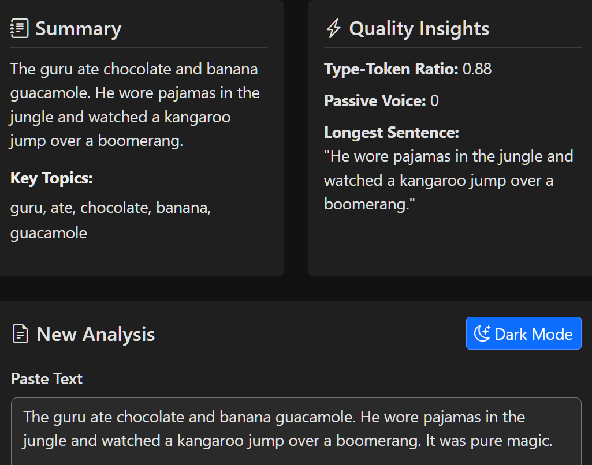
 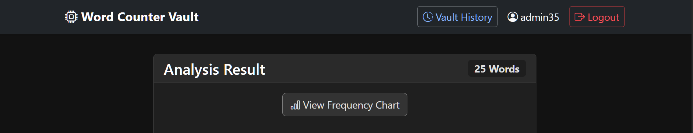
 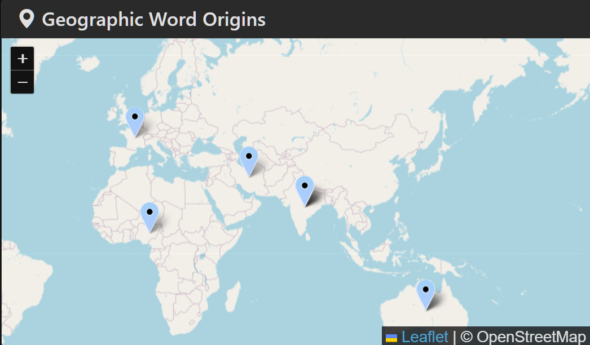
 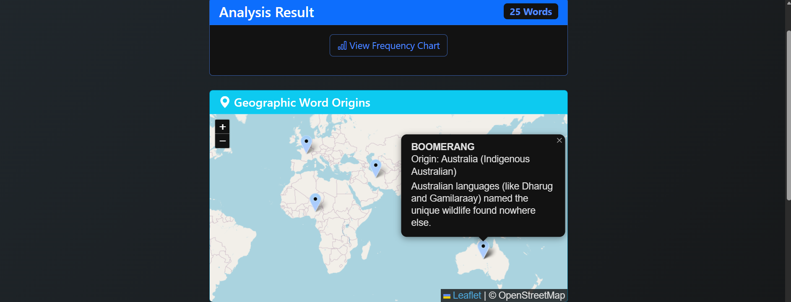
 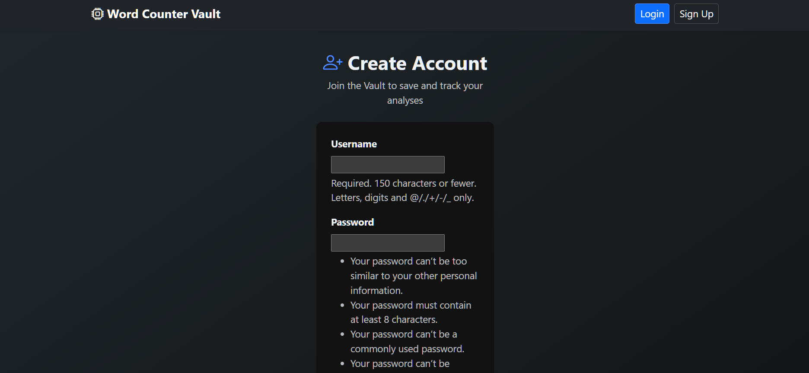
 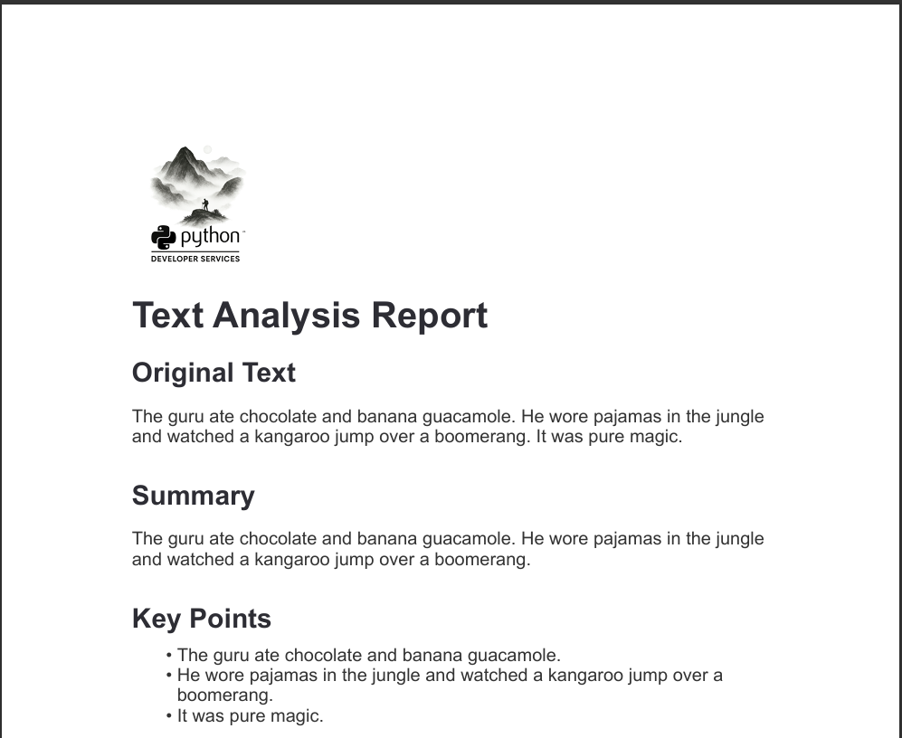
 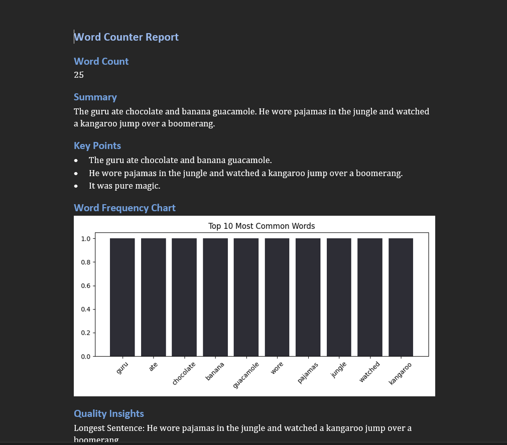
 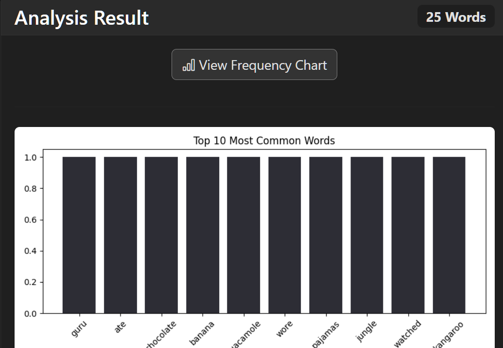
 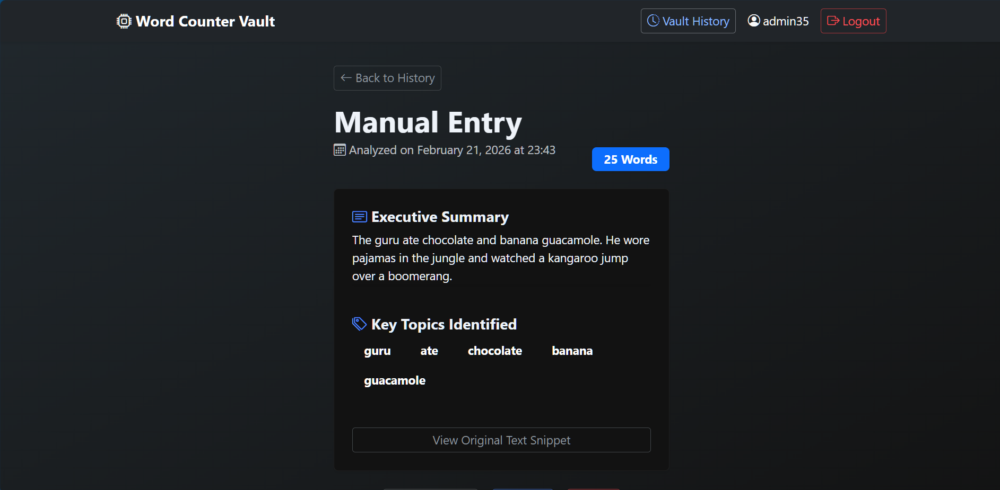
 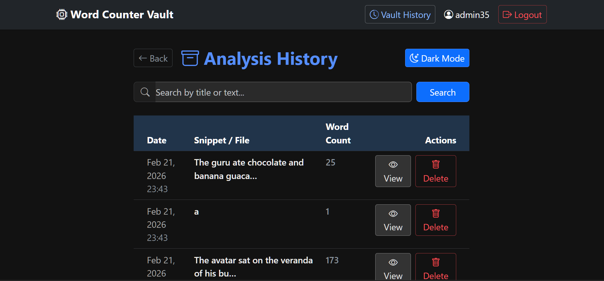
 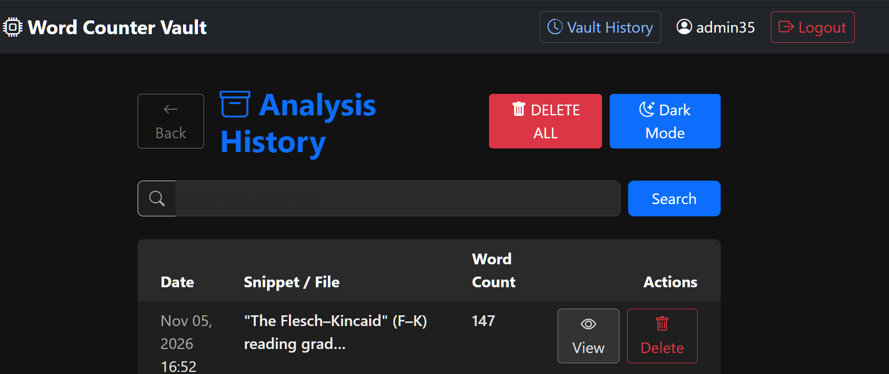

</details>

---

## 📁 Project Architecture

```plaintext
Word-Counter-Vault/
│
├── manage.py                    # Django entry point
├── pyproject.toml               # Project dependencies and configuration
├── pytest.ini                   # Pytest configuration
├── .env.example                 # Example environment variables
├── README.md
├── CONTRIBUTING.md
├── LICENSE
│
├── wordcounterapp/              # Django project configuration
│   ├── __init__.py
│   ├── settings.py              # Global settings
│   ├── urls.py                  # Root URL routing
│   ├── asgi.py
│   └── wsgi.py
│
├── counter/                     # Main application
│   │
│   ├── models.py                # Database models
│   ├── views.py                 # Request handlers
│   ├── urls.py                  # App URL routes
│   ├── admin.py
│   ├── apps.py
│   └── tests.py
│
│   ├── migrations/              # Django database migrations
│   │   ├── 0001_initial.py
│   │   └── 0002_analysisrecord_bullets_and_more.py
│   │
│   ├── services/                # Business logic layer
│   │   ├── analysis.py
│   │   ├── exporters.py
│   │   ├── quality_insights.py
│   │   ├── summarizer.py
│   │   ├── text_extractors.py
│   │   ├── word_selectors.py
│   │   ├── seed_origins.py
│   │   └── word_data.json
│   │
│   ├── templates/               # HTML templates
│   │   │
│   │   ├── counter/
│   │   │   ├── base.html
│   │   │   ├── counter.html
│   │   │   ├── history.html
│   │   │   └── analysis_detail.html
│   │   │
│   │   ├── registration/
│   │   │   ├── login.html
│   │   │   └── register.html
│   │   │
│   │   └── export/
│   │       └── pdf_template.html
│   │
│   └── static/
│       └── counter/
│           ├── css/             # Dashboard styling
│           └── img/             # UI assets
│
├── tests/                       # Pytest test suite
│   ├── test_analysis.py
│   ├── test_extractors.py
│   ├── test_vault.py
│   └── test_views.py
│
├── screenshots/                 # README screenshots
│   ├── user_UI.png
│   ├── user_UI2.png
│   ├── chart.png
│   ├── map.png
│   ├── pdf_report.png
│   └── ...
│
└── analysis/                    # Generated analysis artifacts
    ├── metadata.json
    ├── hashes.json
    └── remaining/
```

---

## 📁 File Structure

* `word_counter/settings.py`: Core configuration for the Django environment.
* `counter/views.py`: Logic for text processing, regex normalization, and dashboard rendering.
* `counter/services/seed_origins.py`: Data pipeline script for ingesting the global word library.
* `counter/services/word_data.json`: The "Source of Truth" containing 500+ global etymology records.
* `word_vault_analytics.duckdb`: High-performance database for geospatial word lookups.

---

## 🧰 Tech Stack

* **Python 3.10** (Development Environment)
* **Django 5.2:** For the web framework and user authentication.
* **DuckDB:** For high-performance, local analytical etymology queries.
* **SQLite:** For persistent user history and session management.
* **Folium/Leaflet:** For interactive geospatial mapping.
* **WeasyPrint / python-docx:** For automated forensic report creation.
* **Regex:** For high-speed text normalization and cleaning.

---

## ⚙️ Installation & Local Usage

To run this project locally:

1. **Clone the repo:** `git clone https://github.com/reory/Word-Counter-Vault.git`
2. **Install dependencies:** `uv sync`
3. **Seed the Global Vault:** `python -m counter.services.seed_origins`
4. **Launch the app:** `python manage.py runserver`

---

## 🧪 Quality Assurance & Testing

This project implements a comprehensive automated testing suite using **Pytest** to ensure data integrity and security across the analytical pipeline.

### Test Coverage:

* **Linguistic Logic:** Validates regex normalization, word frequency calculations, and lexical diversity metrics.
* **Security & Permissions:** Ensures strict object-level access control (e.g., users cannot view or delete others' analysis history).
* **Service Layer & Mocking:** Utilizes `pytest-mock` to simulate **DuckDB** OLAP connections, allowing for high-speed testing without disk I/O dependency.
* **File Extraction:** Verifies robust handling of `.txt`, `.pdf`, and `.docx` uploads using Django's `SimpleUploadedFile`.

### Running Tests Locally:

```bash
pytest
```

---

## 🙏 Acknowledgments

* **Etymology Sources:** Online Etymology Dictionary for root-word tracking.
* **Community:** Thanks to the Django and DuckDB communities for the robust library support.

---

## 🛣️ Roadmap Features

- [x] **Core Architecture:** Dual-Engine (Django + DuckDB) setup.
- [x] **Forensic Reporting:** PDF/WORD export functionality for text analysis.
- [x] **User Accounts:** Private storage for linguistic history.
- [ ] **Data Seeding:** Integration with `Faker` for large-scale stress testing.
- [ ] **Readability Metrics:** Add Flesch Reading Ease, Flesch-Kincaid Grade Level, and Gunning Fog Index calculations for deeper writing quality assessment.
- [ ] **Comparative Analysis:** Compare two text submissions side-by-side to identify differences in vocabulary, lexical diversity, readability, and writing style.
- [ ] **Custom Stopword Management:** Allow users to create personal stopword lists to exclude common or domain-specific words from analysis results.
- [ ] **Analysis Tags & Collections:** Enable users to organize saved analyses into categories, folders, or tagged collections for improved vault management.
- [ ] **Interactive Word Trends:** Track frequently used words across a user's analysis history to visualize vocabulary evolution over time.
- [ ] **Enhanced Geospatial Mapping:** Interactive etymology origins via `Plotly/Mapbox`.

---

**Built By Roy Peters** 😁 [](https://linkedin.com/in/roy-p-74980b382/)
